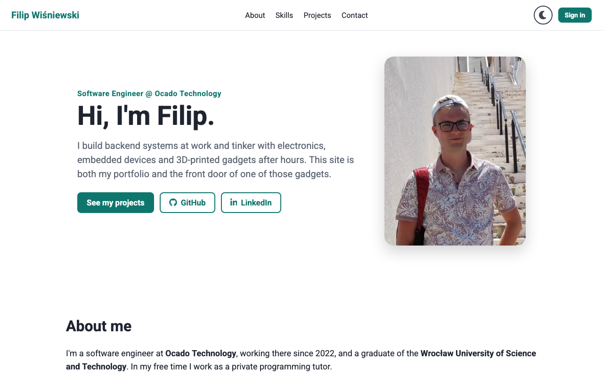
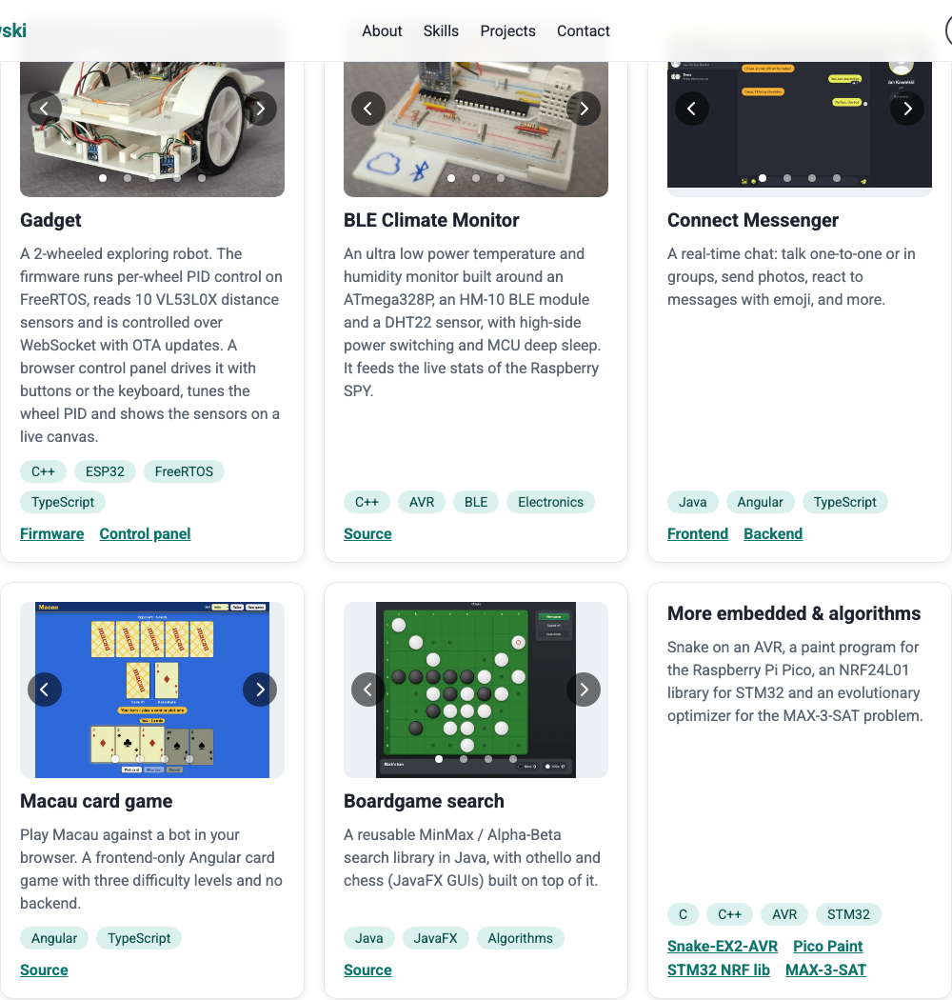
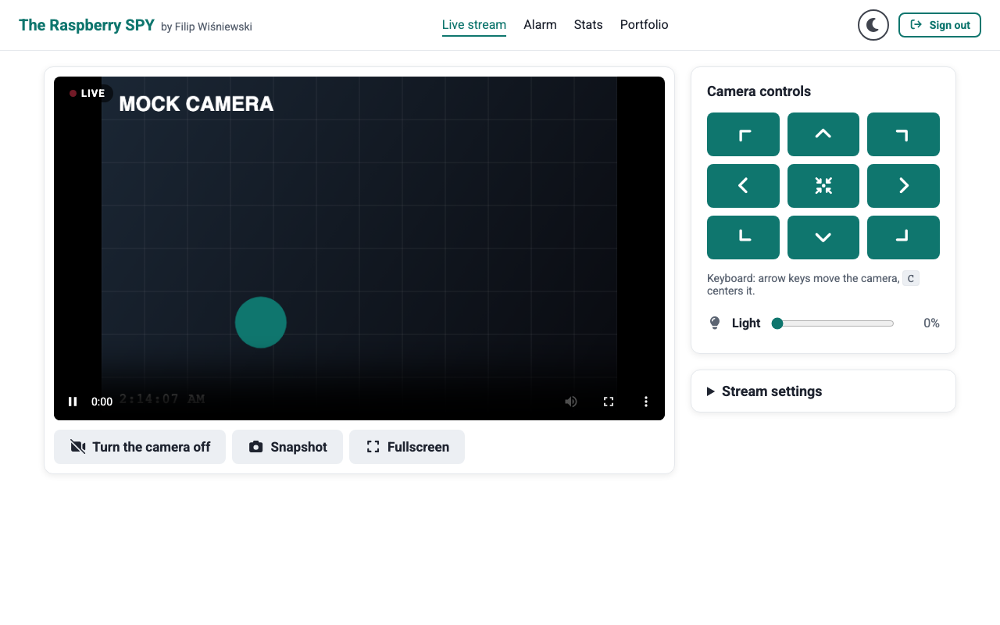
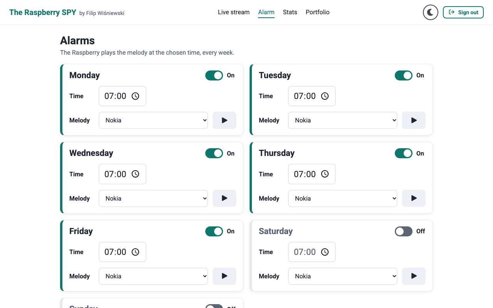
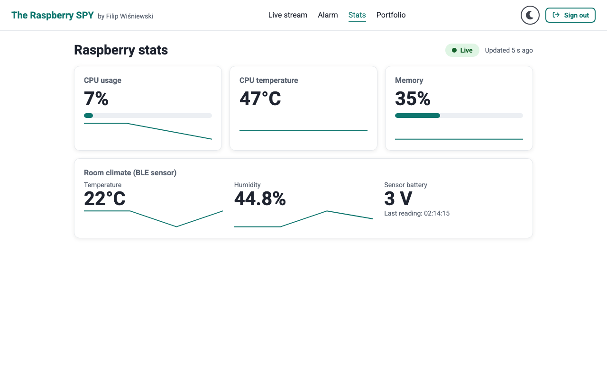
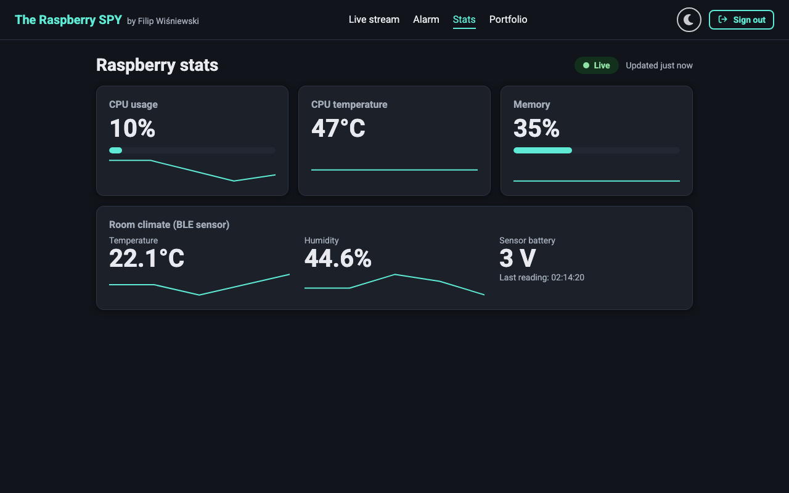
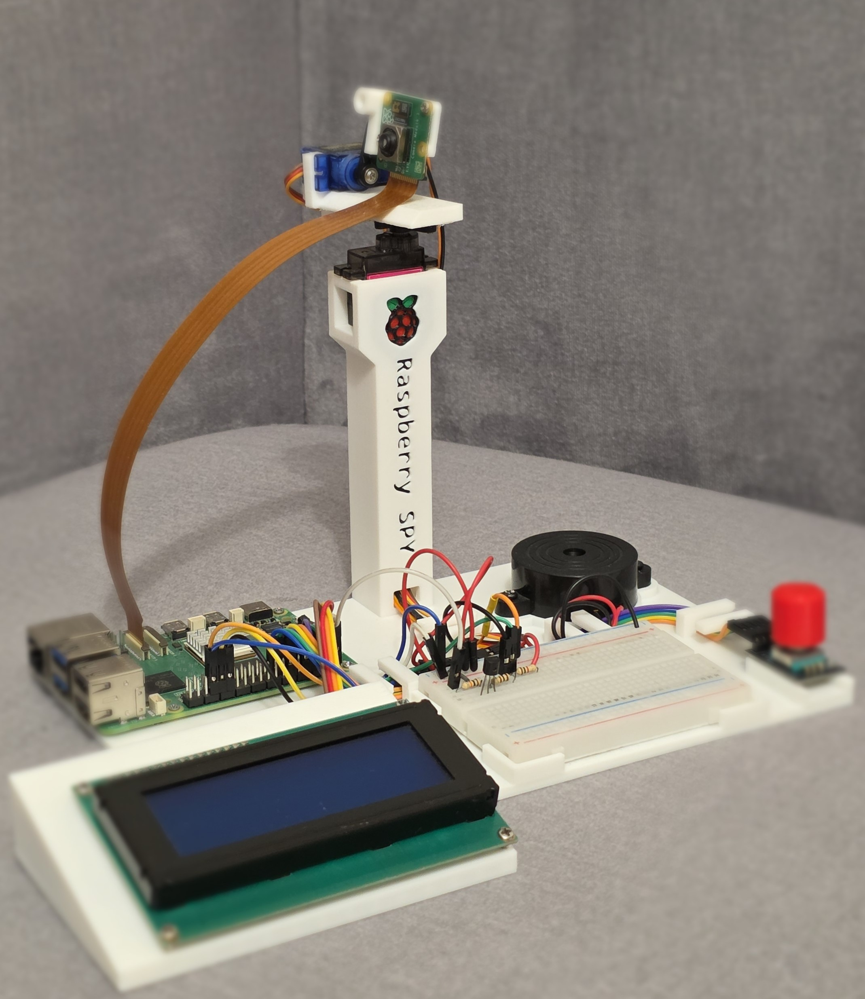
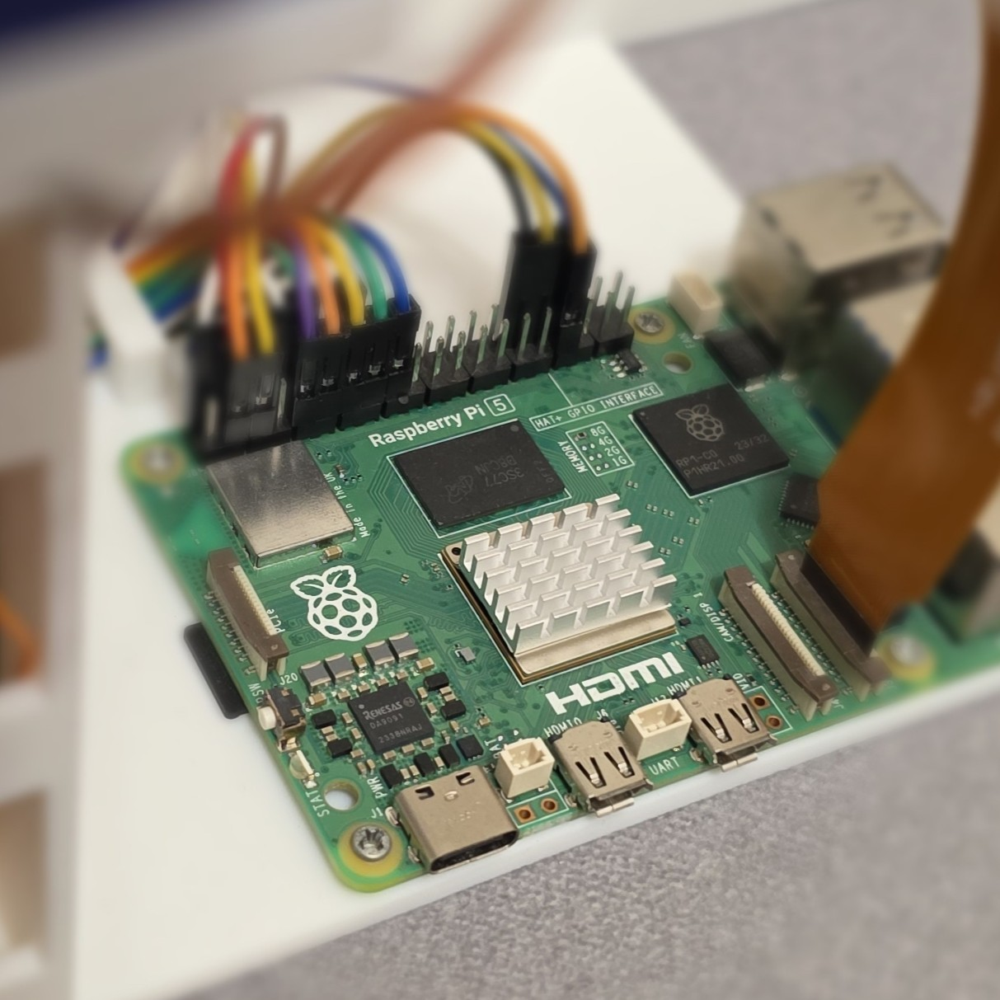
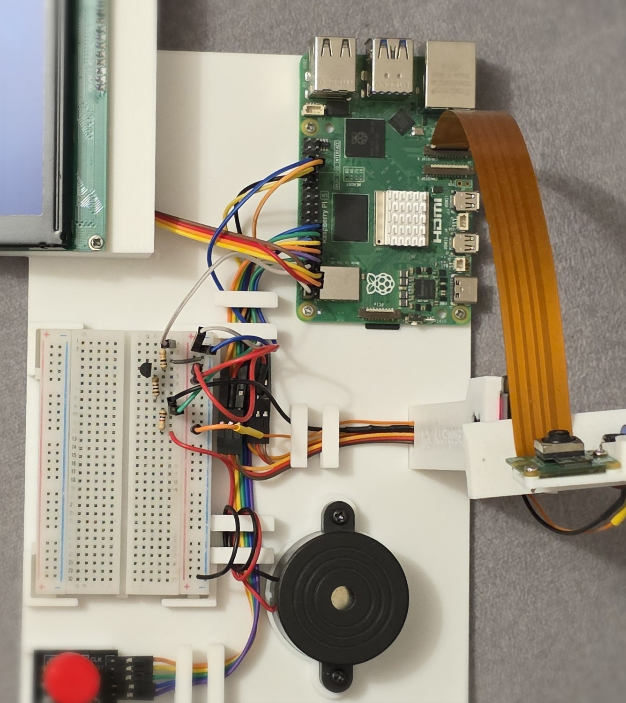

# The Raspberry SPY :eyes:

Hello! Welcome to my repository containing the Raspberry SPY app frontend - developed since I obtained my engineering degree in 2024. It was intended to work as a home monitoring system, but I added some other extra features

#### Current features :on:

- live camera stream (HLS, about 2 s behind live) with a "N s behind live" indicator
- stream settings from the UI: resolution, frame rate, bitrate, exposure, white balance, focus and presets (night, low bandwidth, sharp)
- camera viewing direction control
- adjustable camera backlight
- "local" interface built with 20x4 LCD display and rotary encoder
- programmable alarm clock built with a buzzer and 7 built-in melodies
- live stats dashboard (CPU, temperature, memory, BLE climate sensor) with sparklines
- public portfolio page at `/` (pre-rendered, works with the Raspberry switched off, project galleries, map, chess.com and Duolingo stats), control panel behind a login under `/app`, light and dark theme
- Hosted on GitHub Pages at https://filipwisniewski.pl/ (backend exposed via Cloudflare Tunnel)

Page unavailable? Oops, I must have switched off my raspberry...

#### Development

No Raspberry is needed. Node 22+:

```bash
npm ci
npm run start:mock   # mock backend + UI on http://localhost:4200, login demo / demo
npm run lint
npm run test:ci      # Vitest + coverage thresholds
npm run e2e          # Playwright + axe against the mock backend (first time: npx playwright install chromium)
npm run build        # production build with pre-rendering -> dist/The-Raspberry-SPY-frontend/browser
npm run stats        # refresh the chess.com rating and Duolingo streak shown on the portfolio (CI does it before every build)
npm run contract     # REST + Socket.IO contract checks (mock server, or a backend started with `python main.py --fake`)
```

Pushes to `master` run lint, tests, build and E2E in GitHub Actions and, if all is green, deploy to GitHub Pages. See [AGENTS.md](AGENTS.md) for the architecture and conventions.

#### Components used

:computer: Raspberry Pi 5 module - 8GB RAM version

:camera: 12MPx Raspberry Pi Camera HD v3

:robot: SG90 and MG-90S micro servos

:symbols: 4x20 LCD display

:raised_back_of_hand: Rotary encoder

:speaker: Active buzzer

A custom-made 3D printed frame with a tall camera stand. See it in [Makerworld](https://makerworld.com/pl/models/2886103-the-raspberry-spy#profileId-3223978)

#### Software

:cd: Raspberry Pi OS

:snake: TypeScript + Angular. [Backend](https://github.com/Filip1159/The-Raspberry-SPY-backend) written in Python + FastAPI. As a Java developer I keep struggling with this language, but I find it really educational

:traffic_light: `gpiozero` python library for Raspberry Pi that handles raw GPIO communication

:video_camera: [MediaMTX](https://github.com/bluenviron/mediamtx) server that provides live camera stream via the HLS protocol

:satellite: [Nginx](https://nginx.org/) server configured as a reverse proxy

:earth_africa: [Cloudflare Tunnel](https://developers.cloudflare.com/cloudflare-one/connections/connect-networks/) to expose the backend publicly

#### Screenshots

Taken against the mock backend (`npm run start:mock`).

<table>
  <tr>
    <td width="50%"><br /><sub>Portfolio page</sub></td>
    <td width="50%"><br /><sub>Project cards with image galleries</sub></td>
  </tr>
  <tr>
    <td width="50%"><br /><sub>Live stream and camera controls (mock camera)</sub></td>
    <td width="50%"><br /><sub>Alarm clock</sub></td>
  </tr>
  <tr>
    <td width="50%"><br /><sub>Live stats dashboard</sub></td>
    <td width="50%"><br /><sub>The same page in dark mode</sub></td>
  </tr>
</table>

#### Gallery

<table>
  <tr>
    <td width="50%"><br /><sub>The whole device</sub></td>
    <td width="50%"><br /><sub>The camera</sub></td>
  </tr>
  <tr>
    <td width="50%"><br /><sub>Raspberry Pi 5</sub></td>
    <td width="50%"><br /><sub>Raspberry Pi 5, labelled</sub></td>
  </tr>
  <tr>
    <td width="50%"><br /><sub>Top view</sub></td>
    <td width="50%"></td>
  </tr>
</table>
